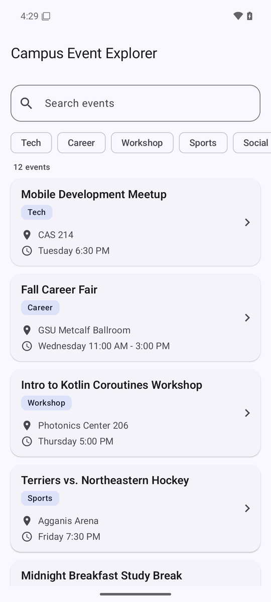
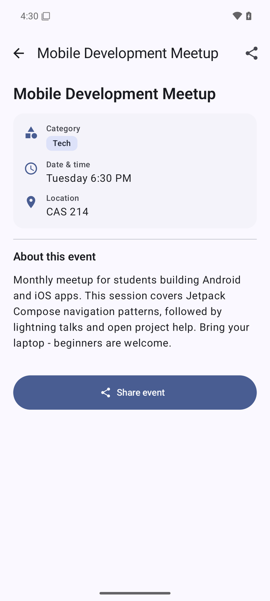
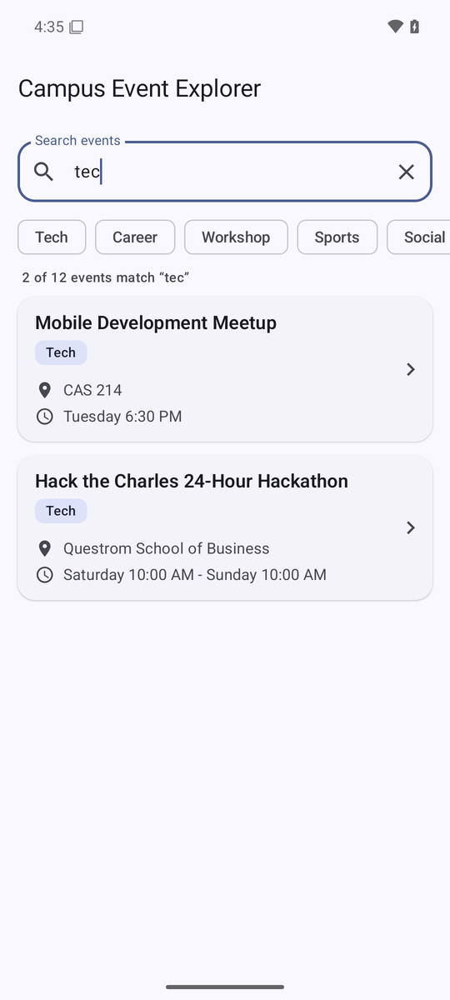
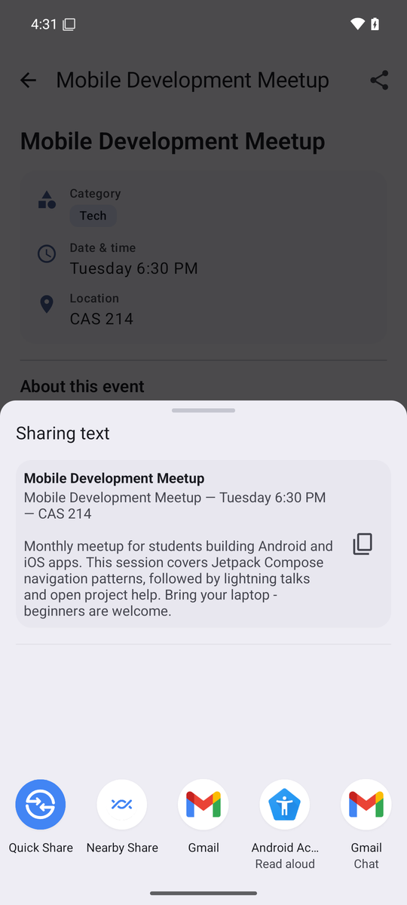
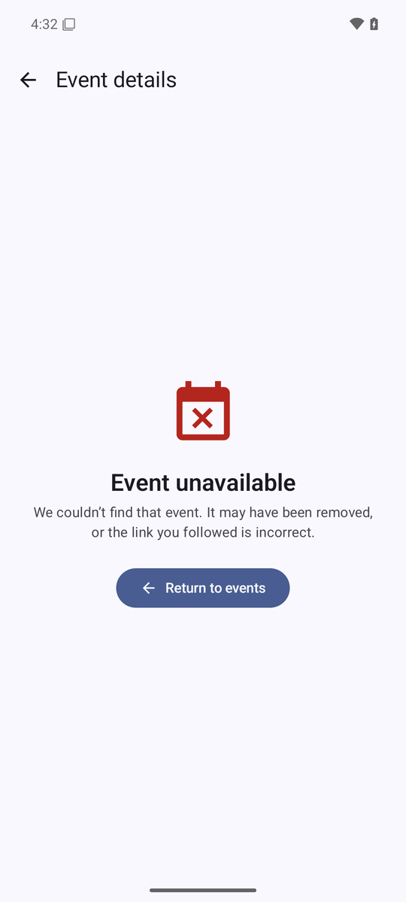

# Campus Event Explorer

**Individual Assignment 3 — Priyanshu Singh (BU ID U73441029)**

A small Android app, written in Kotlin with Jetpack Compose, that lets a user browse campus
events, search them, open an event's details and share it with another app through the system
share sheet.

| Event list | Event detail |
| --- | --- |
|  |  |

| Search as you type | Share sheet (implicit `ACTION_SEND`) | Invalid ID |
| --- | --- | --- |
|  |  |  |

Screenshots were taken on a Pixel 6 emulator (API 35, Material You dynamic colour enabled).

## Features

- **Event list** (start destination): `LazyColumn` keyed by the event's stable `id`, each card
  showing title, category, location and time. Every category gets its own accent colour (badge,
  filter chip and a stripe on the card edge) derived from the Material 3 colour scheme, so it
  adapts to dark mode and Material You.
- **Search events**: filters by title *or* category as you type (case-insensitive, whitespace
  tolerant). The filtered list is *derived* from the search text; there is no second mutable
  list. The text lives in `rememberSaveable`, so it survives rotation and the trip to the
  detail screen and back. Category chips are a shortcut that just type the category for you.
- **Type-safe navigation**: `@Serializable data object EventList` and
  `@Serializable data class EventDetail(val eventId: Long)` with `NavHost`,
  `rememberNavController()`, `composable<T>()`, `navigate(route)` and `toRoute()`. No route
  string is ever built by hand, and only the **event ID** crosses the navigation boundary.
- **Event detail**: title, category, date/time, location and the full description, an app-bar
  Up button and a **Share event** button (plus a share icon in the app bar).
- **Invalid ID handling**: an unknown ID renders *Event unavailable* with a *Return to events*
  button instead of crashing. You can try it with the optional deep link
  `adb shell am start -a android.intent.action.VIEW -d "campusevents://event/999"`.
- **Share via implicit intent**: `ACTION_SEND` + `text/plain`, wrapped in
  `Intent.createChooser()`. The text is `title — time — location`, followed by the description.
- Edge cases covered: whitespace-only search, no matches (empty state with a clear button),
  double-tap on a card or on Up, rotation on either screen, process death, deep links with
  negative / non-numeric / overflowing IDs, devices without any share-capable app, very long
  titles and descriptions, dark theme, dynamic colour and edge-to-edge insets.

## Project structure

```
app/src/main/java/com/priyanshusingh/campuseventexplorer/
├── MainActivity.kt                 single-activity entry point (edge-to-edge)
├── CampusEventExplorerApp.kt       theme + NavHost root
├── data/
│   ├── CampusEvent.kt              the data class required by the assignment
│   ├── EventRepository.kt          12 events with unique, stable IDs + findById()
│   └── EventFilter.kt              pure title/category filtering
├── navigation/
│   ├── Routes.kt                   @Serializable EventList / EventDetail(eventId)
│   ├── CampusEventNavHost.kt       the only place that touches the NavController
│   ├── EventListRoute.kt           owns the search state (rememberSaveable)
│   ├── EventDetailRoute.kt         resolves eventId -> CampusEvent? and wires Share
│   └── NavControllerExt.kt         double-tap-safe navigate helper
├── share/EventSharer.kt            builds + launches the implicit ACTION_SEND intent
└── ui/
    ├── list/
    │   ├── EventListScreen.kt      stateless list screen (search field + LazyColumn)
    │   ├── EventListItem.kt        one card, with a category accent stripe
    │   ├── CategoryFilterRow.kt    quick-filter chips
    │   └── ResultSummary.kt        "2 of 12 events match" caption
    ├── detail/
    │   ├── EventDetailScreen.kt    stateless detail screen (app bar, Up, Share)
    │   ├── DetailHeader.kt         gradient hero banner with the title
    │   ├── DetailRow.kt            icon + label + value row
    │   └── EventUnavailableContent.kt  "Event unavailable" + "Return to events"
    ├── components/                 SearchField, CategoryBadge, EventMetaRow, EmptySearchState
    └── theme/                      Material 3 theme, dark mode, CategoryAccent colours
```

## Running the app

Requirements: Android Studio (Ladybug or newer), JDK 17+, an emulator or device on
Android 7.0 (API 24) or newer.

1. Clone the repository and open the project folder in Android Studio.
2. Let Gradle sync (the wrapper downloads Gradle 8.14; AGP 8.13, Kotlin 2.2).
3. Press **Run** (or `./gradlew installDebug`).

## Tests

```bash
./gradlew testDebugUnitTest            # 63 JVM tests: unit + Robolectric-hosted Compose UI tests
./gradlew connectedDebugAndroidTest    # the same Compose UI tests on a device/emulator, plus a
                                       # physical-rotation test driven by UiAutomator
```

`src/sharedTest` holds Compose UI tests that run in **both** environments. They cover the
screen contracts, the navigation graph (`TestNavHostController`), the full nine-step
rotation-and-state sequence from the assignment (via Activity recreation, and via real rotation
on a device), invalid/negative/malformed IDs, deep links, and the share intent (Espresso
Intents verifies `ACTION_CHOOSER` wrapping an implicit `ACTION_SEND`).

Running `./gradlew testDebugUnitTest --tests "*ScreenshotTest*"` re-renders every screen to
`app/build/screenshots/`.

## Rotation and state test (manual)

1. Launch the application. 2. Type `tech` in *Search events* – only two events remain.
3. Tap *Mobile Development Meetup*. 4. Rotate the emulator (Ctrl+Left / Cmd+Left).
5. The detail destination is still visible. 6. Press Back. 7. The search text `tech` is still
there and the list is still filtered. 8. Tap *Hack the Charles 24-Hour Hackathon*. 9. Press
system Back – you are on the filtered list again. `RotationStateTest` and
`PhysicalRotationTest` automate this exact sequence.

## Questions

**1. Why does the route contain an event ID instead of the complete event object?**
Route arguments are saved into a `Bundle` for rotation and process death, so they should be
small, stable primitives. A `Long` is exactly that. Passing a whole `CampusEvent` would create a
second copy that could drift from the repository, would need `Parcelable`/`@Serializable`, and
would tie the navigation graph to the model's shape. Passing identity and re-looking the event up
(`events.firstOrNull { it.id == route.eventId }`) keeps one source of truth and lets the detail
screen handle a missing event gracefully.

**2. Which composable owns the search state?**
`EventListRoute` (`navigation/EventListRoute.kt`), the state holder composed for the `EventList`
destination. It declares `var query by rememberSaveable { mutableStateOf("") }`, derives the
filtered list from it, and passes `query` + `onQueryChange` down. `EventListScreen` is stateless.

**3. Why does the search value use `rememberSaveable`?**
`remember` only lives as long as the composition; rotation recreates the Activity and would wipe
the text. `rememberSaveable` writes the `String` into saved-instance state scoped to the
`EventList` back-stack entry, so it is restored after rotation, after returning from the detail
screen, and after process death.

**4. What happens to the back stack when an event is selected?**
`navController.navigate(EventDetail(eventId))` pushes a new entry on top of the list:
`[EventList, EventDetail(id)]`. The list entry stays underneath with its saved state, so system
Back or Up pops the detail entry and the list reappears exactly as it was. `launchSingleTop` plus a
`RESUMED` lifecycle check stop a double tap from pushing two detail entries.

**5. How does the UI request navigation without directly accessing the `NavController`?**
Screens expose plain callbacks (`onEventSelected: (Long) -> Unit`, `onBack`, `onShare`).
`CampusEventNavHost` is the only class that holds the controller; inside each `composable<...>`
block it supplies lambdas that call `navigate(...)` / `navigateUp()`. The screens just invoke the
lambda they were given - state flows down, events flow up.

**6. What makes the Share action an implicit intent?**
The intent describes *what* to do, not *who* should do it: `Intent(Intent.ACTION_SEND)` with
`type = "text/plain"` and `EXTRA_TEXT`, and no component or package set. Android resolves every
activity whose filter matches, and `Intent.createChooser()` shows them in the system share sheet
instead of targeting one app.

## AI / collaboration disclosure

This project was developed by Priyanshu Singh with the assistance of an AI coding agent
(Cursor, Claude). The AI was used to scaffold the project, draft the Compose screens, the
navigation wiring and the test suite, and to review edge cases; I directed the requirements,
reviewed every file, ran the build and tests, and am responsible for the final submission. No
other students collaborated on this assignment. Android documentation for Navigation Compose
(type-safe routes), `rememberSaveable` and `Intent.createChooser()` was consulted.
